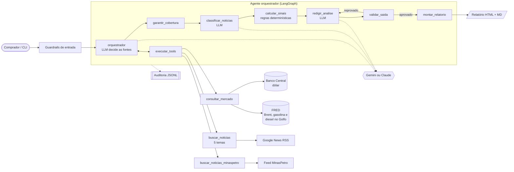

# Fuel Purchase Agent

Agente de IA que ajuda o responsável de compras de um **posto Shell (Raízen) em Lavras (MG)**
a decidir **quando comprar combustível na distribuidora** (bases de Betim e Paulínia). Para
cada produto, ele diz se o preço de compra tende a **subir** (→ **ANTECIPAR** a compra),
**cair** (→ **ADIAR**) ou se não há sinal claro (→ **MANTER ROTINA**), para os próximos 7 dias.

Produtos: gasolina comum, gasolina Shell V-Power, etanol hidratado, etanol Shell V-Power e
diesel S10.

📊 **Exemplo real:** [`docs/exemplo-relatorio/relatorio.md`](docs/exemplo-relatorio/relatorio.md)
(com a [trilha de auditoria](docs/exemplo-relatorio/auditoria.jsonl) da execução).

> O agente não prevê o preço exato nem consulta o preço da distribuidora (o comprador já o
> tem). Ele lê o que **move** esse preço e indica a direção mais provável, com nível de
> confiança. É apoio à decisão, não garantia.

---

## Como funciona



1. **Coleta.** O orquestrador (LLM) chama as tools: mercado, cinco temas de notícias
   (Petrobras, impostos, geopolítica, etanol, distribuição) e o feed da MinasPetro. Se
   esquecer alguma fonte, o grafo a executa mesmo assim.
2. **Classificação.** O LLM classifica cada notícia: se afeta o preço de compra, em que
   direção, com que intensidade, quais produtos e se é **fato confirmado com data** (ex.:
   reajuste anunciado) ou só possibilidade.
3. **Sinal (código, não LLM).** Para cada produto, combina:
   - **Mercado:** variação em 7 e 30 dias do dólar e dos preços internacionais em reais
     (Brent, gasolina e diesel no Golfo dos EUA, principal origem das importações).
   - **Notícias:** soma por tema (direção × intensidade × recência), com teto por tema.
4. **Decisão.**
   - Pontuação ≥ +0,2 → **ANTECIPAR**; ≤ −0,2 → **ADIAR**; entre os dois → **MANTER ROTINA**.
   - **Fato confirmado** de reajuste da Petrobras ou de tributo, com vigência nos próximos
     7 dias, define a direção com confiança alta.
   - **Sinais conflitantes** (mercado e notícias puxando forte para lados opostos) →
     **MANTER ROTINA**: antecipar ou adiar tem custo e não deve se basear em evidências
     contraditórias.
5. **Explicação.** O LLM escreve a justificativa de cada decisão **sem poder alterá-la**; a
   validação confere números e coerência.

### Pesos por produto

| Produto | Peso do mercado | Indicadores de mercado | Observação |
|---|---|---|---|
| Gasolina comum e V-Power | 40% | gasolina Golfo 60%, Brent 20%, dólar 20% | V-Power acompanha a comum |
| Etanol e etanol V-Power | 10% | gasolina Golfo 50%, dólar 50% | Formado no mercado interno (safra, usinas, Paulínia): depende mais de notícias |
| Diesel S10 | 50% | diesel Golfo 60%, Brent 20%, dólar 20% | Muito sensível ao mercado internacional |

| Tema de notícia | Peso | Por quê |
|---|---|---|
| Petrobras (reajustes) | 1,0 | Muda diretamente o preço de compra |
| Impostos (ICMS, PIS/Cofins, CIDE, desonerações) | 1,0 | Muda diretamente o preço de compra |
| Distribuição (bases, abastecimento) | 0,7 | Efeito direto, mas local/temporário |
| Etanol (safra, usinas) | 0,7 | Principal fator do etanol |
| Geopolítica (guerra, OPEP) | 0,3 | O efeito no petróleo já entra pelo mercado: sozinha não decide |

Os parâmetros ficam em [`signals.py`](src/fuel_agent/signals.py) e
[`products.py`](src/fuel_agent/products.py).

## Fontes de dados

| Fonte | Dado | Acesso |
|---|---|---|
| [Banco Central (SGS 1)](https://api.bcb.gov.br/dados/serie/bcdata.sgs.1/dados/ultimos/5?formato=json) | Dólar comercial (venda), diário | API pública, sem chave |
| [FRED / EIA](https://fred.stlouisfed.org/series/DCOILBRENTEU) | Brent (`DCOILBRENTEU`), gasolina (`DGASUSGULF`) e diesel (`DDFUELUSGULF`) no Golfo dos EUA, diários | CSV público, sem chave |
| [Google News](https://news.google.com) | Notícias dos últimos 10 dias por tema, com consultas fixas | RSS público |
| [MinasPetro](https://minaspetro.com.br/noticias/) | Notícias do sindicato do comércio de combustíveis de MG | Feed RSS oficial |

## Guardrails

| Camada | Controle |
|---|---|
| **Entrada** | Produtos em lista fechada; pergunta opcional limitada a 300 caracteres, restrita ao tema, sem injeção de instruções nem dados pessoais. Bloqueio antes de qualquer chamada ao LLM. |
| **Tools** | Argumentos em enumeração fechada (o LLM escolhe o tema, nunca o texto da busca ou a URL); limite de passos; cobertura obrigatória de todas as fontes. |
| **Conteúdo externo** | Notícias com padrões de injeção são descartadas; CPF, CNPJ, e-mail e telefone são mascarados; o texto chega ao LLM marcado como não confiável. |
| **Classificação** | ids inexistentes ou repetidos são descartados; notícia com linguagem de possibilidade ("pode", "avalia", "proposta") não pode ser **fato confirmado**. |
| **Decisão** | Calculada por código. Só reajuste da Petrobras e tributos podem definir a decisão sozinhos; sinais conflitantes levam a MANTER ROTINA. |
| **Saída** | Percentuais e valores citados precisam existir nos dados ou nas notícias; a justificativa não pode contradizer a decisão (ex.: "adiar a compra" num produto ANTECIPAR); ids citados precisam existir. Reprovação gera reescrita com o motivo. |
| **Resiliência** | Novas tentativas com espera (10 s, 30 s) e modelo reserva quando o Gemini está sobrecarregado; fonte de notícia fora do ar não derruba a execução. |

> Exemplos reais que viraram regras: "desoneração **pode** terminar em 9/10" foi marcada
> como fato pelo LLM (agora o guardrail desmarca); oito notícias repetindo "petróleo sobe
> 4%" saturavam o sinal (agora há teto por tema e peso menor para geopolítica).

## Governança e auditoria

Cada execução grava `logs/audit/<run_id>.jsonl` (append-only) com: pedido; decisões do
orquestrador; argumentos, duração e resultado de cada tool; cada chamada ao LLM (modelo,
tokens, hash do prompt); novas tentativas e troca de modelo; classificação de cada notícia;
os sinais calculados com seus fatores; e cada decisão dos guardrails. O relatório informa o
modelo usado e o id da execução.

## Como executar

Requisitos: Python 3.11+ e uma chave gratuita do [Google AI Studio](https://aistudio.google.com/apikey)
(ou uma chave da Anthropic, com `FUEL_LLM_PROVIDER=claude`).

```bash
python -m venv .venv
.venv\Scripts\activate             # Linux/macOS: source .venv/bin/activate
pip install -e ".[dev]"
copy .env.example .env             # e preencha GEMINI_API_KEY
```

```bash
python -m fuel_agent                                   # todos os produtos
python -m fuel_agent --produtos diesel_s10,etanol      # só alguns
python -m fuel_agent --foco "O fim da desoneração afeta o etanol?"
```

O relatório sai em `outputs/<run_id>/relatorio.html` (e `.md`, com dois gráficos). Rode antes
de cada compra (o posto compra em média **2 vezes por semana**); uma execução leva cerca de
1 a 3 minutos (as notícias do dia são buscadas na hora).

Cada decisão vem traduzida para o ritmo de compras:

| Decisão | Na prática (2 compras por semana) |
|---|---|
| 🔺 ANTECIPAR | Antecipe a próxima compra ou aumente o volume desta para cobrir também a seguinte, se houver espaço no tanque. |
| 🔻 ADIAR | Compre só o necessário até a próxima compra (~4 dias) e reavalie antes dela; evite estoque extra. |
| ➖ MANTER ROTINA | Siga a rotina de 2 compras por semana e reavalie na próxima. |

| Variável (`.env`) | Padrão | Descrição |
|---|---|---|
| `FUEL_LLM_PROVIDER` | `gemini` | `gemini` ou `claude` |
| `FUEL_LLM_MODEL` | `gemini-3.8-flash` | modelo principal |
| `FUEL_LLM_FALLBACK_MODEL` | `gemini-3.5-flash-lite` | modelo reserva |
| `FUEL_HORIZON_DAYS` | `7` | horizonte da decisão (cobre as duas próximas compras) |
| `FUEL_PURCHASES_PER_WEEK` | `2` | ritmo de compras usado na orientação prática |
| `FUEL_NEWS_MAX_AGE_DAYS` | `10` | idade máxima das notícias |

## Testes

```bash
pytest            # 42 testes, sem rede e sem LLM real
ruff check src tests && ruff format --check src tests
```

Cobrem o cálculo do sinal (mercado, teto por tema, eventos confirmados, conflito, recência),
leitura das fontes, guardrails, o agente ponta a ponta com Gemini simulado e as novas
tentativas/modelo reserva.

## Estrutura

```text
src/fuel_agent/
├── __main__.py      # CLI
├── agent.py         # grafo LangGraph
├── tools.py         # tools + RunContext
├── market.py        # dólar (BCB) e petróleo/derivados (FRED) em R$
├── news.py          # Google News por tema + MinasPetro
├── signals.py       # classificação (schema) e cálculo determinístico da decisão
├── products.py      # produtos e pesos
├── guardrails.py    # entrada, conteúdo externo, saída
├── analysis.py      # formato do texto do LLM
├── prompts.py       # prompts versionados
├── charts.py        # gráficos
├── report.py        # relatório HTML/MD
├── audit.py         # trilha de auditoria
├── http.py          # cliente HTTP (User-Agent e novas tentativas)
└── llm/             # interface + adaptadores Gemini e Claude
```

## Limitações e próximos passos

- **Validar o sinal.** Os pesos foram definidos por raciocínio, não ajustados a dados. O posto
  não tem histórico de preços de compra; a partir de agora, anotar a data, o produto e o preço
  de cada compra (2 por semana) permite medir em poucos meses quantas vezes o sinal acertou e
  calibrar os pesos. Uma alternativa imediata é testar o componente de mercado contra a série
  semanal de preços da ANP em MG, que acompanha o preço da distribuidora com atraso.
- **Defasagem em relação à paridade de importação.** Informando o preço atual da Petrobras,
  o agente poderia estimar a defasagem, um dos melhores indicadores de reajuste.
- **Etanol.** Integrar o indicador CEPEA/Paulínia (hoje acessado só via notícias).
- **Qualidade da classificação.** Quando o Gemini principal está sobrecarregado, o modelo
  reserva classifica pior; a regra de sinais conflitantes reduz o impacto, mas usar um
  modelo mais forte (ou a Claude) melhora o resultado.
- **Operação.** Agendar a execução diária e enviar o resumo por e-mail ou WhatsApp.
