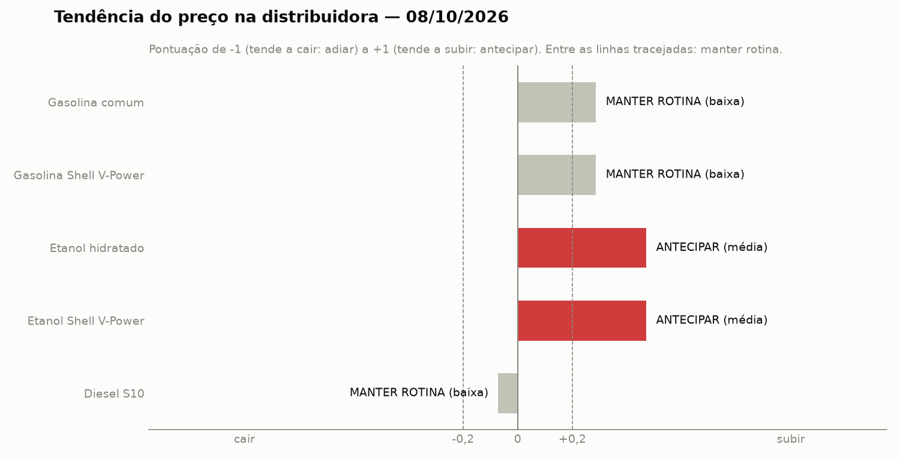
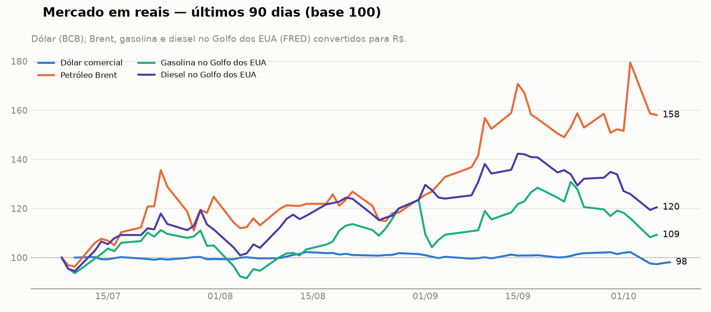

# Recomendação de compra de combustível — 08/10/2026

Posto Shell · Lavras (MG) · bases de Betim e Paulínia · horizonte de
7 dias · gerado em 08/10/2026 20:10 UTC · execução
<code>20261008T200755Z-1373327a</code>

## Decisão por produto

| Produto | Decisão | Confiança | Pontuação (mercado / notícias) |
|---|---|---|---|
| Gasolina comum | ➖ **MANTER ROTINA** | baixa | +0,29 (-0,37 / +0,73) |
| Gasolina Shell V-Power | ➖ **MANTER ROTINA** | baixa | +0,29 (-0,37 / +0,73) |
| Etanol hidratado | 🔺 **ANTECIPAR** | média | +0,47 (-0,73 / +0,60) |
| Etanol Shell V-Power | 🔺 **ANTECIPAR** | média | +0,47 (-0,73 / +0,60) |
| Diesel S10 | ➖ **MANTER ROTINA** | baixa | -0,07 (-0,43 / +0,29) |

## Resumo

Prezado responsável de compras do posto em Lavras, o cenário para os próximos 7 dias apresenta sinais conflitantes no mercado internacional e interno, exigindo cautela. O dólar comercial está cotado a 5,01 R$/US$, com variação de -3,8% em 7 dias e -1,4% em 30 dias. Enquanto o Petróleo Brent subiu para 623,41 R$/barril (+4,8% em 7 dias e +19,0% em 30 dias), os derivados no Golfo dos EUA recuaram, gerando incertezas. A recomendação geral é manter a rotina para a maioria dos combustíveis, exceto para o etanol, onde a indicação é antecipar as compras devido a fatores específicos de safra e tributação.

## Justificativa por produto

### ➖ Gasolina comum: MANTER ROTINA (confiança baixa)

Mantemos a rotina com confiança baixa devido aos sinais conflitantes no mercado. Temos a alta do petróleo Brent e o risco do fim da desoneração de PIS/Pasep e Cofins em 9 de outubro (notícia 2), contrapondo-se à queda da gasolina no Golfo dos EUA (-6,6% em 7 dias) e a recuo do dólar comercial a 5,01 R$/US$ (-3,8% em 7 dias).

**Sinais conflitantes:** mercado e notícias apontam para lados opostos; por isso a recomendação é manter a rotina.

<small>Principais fatores:</small>

- 📈 [2] Gasolina e etanol: desoneração pode terminar em 9 de outubro
- 📉 Gasolina no Golfo dos EUA: -6,6% em 7 dias, -0,1% em 30 dias
- 📈 Petróleo Brent: +4,8% em 7 dias, +19,0% em 30 dias
- 📉 Dólar comercial: -3,8% em 7 dias, -1,4% em 30 dias
- 📈 [27] EUA impõem novas sanções à rede de transporte de petróleo do Irã
- 📈 [33] EUA impõem novas sanções ao Irã visando embarcações de transporte de petróleo

### ➖ Gasolina Shell V-Power: MANTER ROTINA (confiança baixa)

A decisão é manter a rotina com confiança baixa pelos mesmos motivos da gasolina comum. O cenário opõe a alta de 4,8% em 7 dias do petróleo Brent e a possível virada tributária em 9 de outubro (notícia 2) à retração da gasolina no Golfo dos EUA (-6,6% em 7 dias).

**Sinais conflitantes:** mercado e notícias apontam para lados opostos; por isso a recomendação é manter a rotina.

<small>Principais fatores:</small>

- 📈 [2] Gasolina e etanol: desoneração pode terminar em 9 de outubro
- 📉 Gasolina no Golfo dos EUA: -6,6% em 7 dias, -0,1% em 30 dias
- 📈 Petróleo Brent: +4,8% em 7 dias, +19,0% em 30 dias
- 📉 Dólar comercial: -3,8% em 7 dias, -1,4% em 30 dias
- 📈 [27] EUA impõem novas sanções à rede de transporte de petróleo do Irã
- 📈 [33] EUA impõem novas sanções ao Irã visando embarcações de transporte de petróleo

<small>Acompanha a gasolina comum (mesma base, com aditivos).</small>

### 🔺 Etanol hidratado: ANTECIPAR (confiança média)

Recomendamos antecipar as compras com confiança média. O produto é sustentado pela recuperação de preços e impactos de chuvas prejudicando a colheita da cana (notícias 34, 39 e 40), além da possível desoneração federal que pode terminar em 9 de outubro (notícia 2).

<small>Principais fatores:</small>

- 📈 [2] Gasolina e etanol: desoneração pode terminar em 9 de outubro
- 📈 [34] Preços do açúcar superam 20 centavos e etanol apresenta recuperação no Brasil
- 📈 [39] Preços do etanol e do açúcar subiram em setembro com chuvas prejudicando colheita da cana
- 📉 [40] Chuvas elevam açúcar no mercado spot paulista; etanol hidratado recua
- 📉 Dólar comercial: -3,8% em 7 dias, -1,4% em 30 dias
- 📉 Gasolina no Golfo dos EUA: -6,6% em 7 dias, -0,1% em 30 dias

### 🔺 Etanol Shell V-Power: ANTECIPAR (confiança média)

A orientação é antecipar com confiança média, acompanhando o comportamento do hidratado. Pesam a favor da compra antecipada a alta do açúcar, as chuvas na colheita da cana em setembro (notícias 34, 39 e 40) e o fim potencial da desoneração em 9 de outubro (notícia 2).

<small>Principais fatores:</small>

- 📈 [2] Gasolina e etanol: desoneração pode terminar em 9 de outubro
- 📈 [34] Preços do açúcar superam 20 centavos e etanol apresenta recuperação no Brasil
- 📈 [39] Preços do etanol e do açúcar subiram em setembro com chuvas prejudicando colheita da cana
- 📉 [40] Chuvas elevam açúcar no mercado spot paulista; etanol hidratado recua
- 📉 Dólar comercial: -3,8% em 7 dias, -1,4% em 30 dias
- 📉 Gasolina no Golfo dos EUA: -6,6% em 7 dias, -0,1% em 30 dias

<small>Acompanha o etanol hidratado (mesma base, com aditivos).</small>

### ➖ Diesel S10: MANTER ROTINA (confiança baixa)

A decisão é manter a rotina com confiança baixa. O diesel no Golfo dos EUA registrou forte queda de -10,7% em 7 dias e o dólar recuou a 5,01 R$/US$ (-3,8% em 7 dias), contrabalanceando a alta de 4,8% em 7 dias do petróleo Brent e as sanções ao Irã (notícias 27 e 33).

**Sinais conflitantes:** mercado e notícias apontam para lados opostos; por isso a recomendação é manter a rotina.

<small>Principais fatores:</small>

- 📉 Diesel no Golfo dos EUA: -10,7% em 7 dias, -2,9% em 30 dias
- 📈 Petróleo Brent: +4,8% em 7 dias, +19,0% em 30 dias
- 📉 Dólar comercial: -3,8% em 7 dias, -1,4% em 30 dias
- 📈 [27] EUA impõem novas sanções à rede de transporte de petróleo do Irã
- 📈 [33] EUA impõem novas sanções ao Irã visando embarcações de transporte de petróleo
- 📈 [26] Petróleo fecha com alta de 4% em meio a ataques no Oriente Médio, apesar de falas de Trump

## Mercado

| Indicador | Último valor | Data | 7 dias | 30 dias |
|---|---|---|---|---|
| Dólar comercial | 5,01 R$/US$ | 08/10/2026 | -3,8% | -1,4% |
| Petróleo Brent | 623,41 R$/barril | 06/10/2026 | +4,8% | +19,0% |
| Gasolina no Golfo dos EUA | 4,68 R$/litro | 06/10/2026 | -6,6% | -0,1% |
| Diesel no Golfo dos EUA | 5,99 R$/litro | 06/10/2026 | -10,7% | -2,9% |

O cenário internacional é marcado pelo Petróleo Brent a 623,41 R$/barril, acumulando alta de +4,8% em 7 dias e +19,0% em 30 dias, impulsionado por tensões e sanções no Oriente Médio (notícias 27, 33). Em contrapartida, o dólar comercial caiu para 5,01 R$/US$ (-3,8% em 7 dias e -1,4% em 30 dias) e os produtos refinados no Golfo dos EUA mostraram desvalorização nos últimos 7 dias, com a gasolina a 4,68 R$/litro (-6,6%) e o diesel a 5,99 R$/litro (-10,7%). No mercado interno, o foco recai sobre o possível fim da desoneração de PIS/Cofins em 9 de outubro (notícia 2) e o impacto das chuvas na oferta de cana-de-açúcar (notícia 39).

## Notícias consideradas

| # | Data | Notícia | Efeito | Produtos |
|---|---|---|---|---|
| 2 | 08/10 | [Gasolina e etanol: desoneração pode terminar em 9 de outubro](https://minaspetro.com.br/gasolina-e-etanol-desoneracao-pode-terminar-em-9-de-outubro/) — MinasPetro <small>Possivel fim de desoneracao de PIS/Cofins pode elevar os custos de aquisicao.</small> | ↑ alta (moderada) | Gasolina comum, Gasolina Shell V-Power, Etanol hidratado, Etanol Shell V-Power |
| 11 | 08/10 | [Petrobras anula reajuste que faria da gasolina após nova desoneração do governo](https://news.google.com/rss/articles/CBMirAFBVV95cUxQZ1N4dkxZU2diWkY3MDBIMzJ2NG9ic1ZwR2FZVDhhOXhaYlBuLVZzWlZYN0htZ2RjMUVsX3ZnOWJkdzNwNkVLTkNQR1NSRmVvaEN5SUlMWDV6Z0Z6SHhIUy1JS2xIMGJzWmNfTEJmS0tuT3g4eTdydzVMQjhsVV9JSWM0V1JUR2NwaUdQWXc3VkcyWk9BOTVNZllzNGpQNXJYa3RUUVRTNS1qeWRL?oc=5) — Gazeta do Povo <small>Anulacao de reajuste evita nova alta, mantendo os precos estaveis.</small> | → neutra (fraca) · confirmado | Gasolina comum, Gasolina Shell V-Power |
| 17 | 05/10 | [Preço do diesel no Brasil dispara com retomada da guerra no Irã e ameaça às exportações dos EUA](https://news.google.com/rss/articles/CBMi4AFBVV95cUxPQVlqMTBYcnlaTk5qQzNoX0paOGxfenFVbzlhZmV1Q1NTMkJteGpzMkRyLWdGNFkwdWFzT0tZOXJLTTM0OER5RUd6dWJLVFVwYWZ6Rm1aOTFMdGt1cVRsSGVXZGNfTXJFbHZoS280d0FtRHRoYVJ4QktRejlsVHo2UlJCLWNpNU5rTVpFV1JLRVBpbnkxQlRFSERka2ZuRFpYTzRpYVhNWFM0ODRQZnBSVWdmV1JjeGFFTWJrZDJCVDBEM3RUczZ2NFVLRExLa2c3QUhfQmxEa2s0d3NHaFVVRg?oc=5) — Folha de S.Paulo <small>Tensões geopolíticas e impacto no mercado internacional de petróleo.</small> | ↑ alta (fraca) | Diesel S10, Gasolina comum, Gasolina Shell V-Power |
| 26 | 08/10 | [Petróleo fecha com alta de 4% em meio a ataques no Oriente Médio, apesar de falas de Trump](https://news.google.com/rss/articles/CBMiywFBVV95cUxOcGN4ZGVnaGJoSHBla3IwR250V2x1dlFiS2RlaWNVel83YlU4TmlxMkhQQmhUZWlzX1FxNC1ZbmF0RDJ6eC1RTnh1emVaWVdrRmloZkVvOUE1dDRNLWs3T0t4OG5aYm9Ib1h1b2RQWTJPc3BXNDFuaXREdFljR0d6R24xVzcxbTlDTDV2N1l1Zi1aLWd6YnltRzZZN3dNYUhHSzFRYTJIYnVING5fXzJEYVRvWjhaWENTT0pxOWZaclBQbzgteElQbnVaSQ?oc=5) — Times Brasil | CNBC <small>Alta do petroleo por conflitos no Oriente Medio.</small> | ↑ alta (fraca) | Gasolina comum, Gasolina Shell V-Power, Diesel S10 |
| 27 | 08/10 | [EUA impõem novas sanções à rede de transporte de petróleo do Irã](https://news.google.com/rss/articles/CBMivAFBVV95cUxPTnp5QW1VT3hpS3lWbk15c0ZJZDc3dFVOX3RhZ2Z1a0ZSY25hNFhjU2J2LWY2Um9ZZHNBTC03cEhRR3l4OHJ1OEt2VVdwTEtxd0kxTXVrSDFmbnc4Z09yS2tlQjlLY0tkS1I1U2R4Z1NmOGZpXzhqZmh4aGs4QjRyMjVaeXNLUkNWMU1lVnVmRU9KamFRVlkzZXpIQnFZbHozQmxxZG5FcklrSjBaMmt4TDJVLUdlcngwdHdHNQ?oc=5) — Investing.com Brasil - Finanças, Câmbio e Investimentos <small>Sancoes ao Iran afetam a oferta global de petroleo.</small> | ↑ alta (fraca) · confirmado | Gasolina comum, Gasolina Shell V-Power, Diesel S10 |
| 28 | 08/10 | [Petróleo avança 4% com aumento das tensões no Oriente Médio](https://news.google.com/rss/articles/CBMiYkFVX3lxTE1OLWh4UW1PZkRuN1RtMnFCd0pRNTVSVWJobUJZa1pwYzdMRDRPT2Q3Q1lfblpzR0JobTZOU181OVd3NVZkY2N1SFRGQTh1TUs2RExxem5WU3RkUVo5YlZnb19n?oc=5) — Money Times <small>Avanco nos precos do petroleo devido a tensoes.</small> | ↑ alta (fraca) | Gasolina comum, Gasolina Shell V-Power, Diesel S10 |
| 29 | 08/10 | [Petróleo fecha em alta firme com guerra e queda na produção dos EUA](https://news.google.com/rss/articles/CBMiiwFBVV95cUxQWXNMNUJ4OTJPR3ZNNlRfTmgwYzRqakp1QlphaXdHX1pmRkMwblRVSWhZdHZTMHUxZ1h4cVhUTHN1NV9RQnNHQkpjSUdaNkhBbVFyZ01icEdwSEhzcjE5dmJxc3I1SGZia0JsNWtiYjBTNG16YnlDaEVQNTktUUVxdWdGQUl1Ny13dTBV?oc=5) — CNN Brasil <small>Guerra e queda de producao nos EUA pressionam o petroleo.</small> | ↑ alta (fraca) | Gasolina comum, Gasolina Shell V-Power, Diesel S10 |
| 30 | 08/10 | [Petróleo sobe mais de 4% com ataques no Oriente Médio e risco à oferta](https://news.google.com/rss/articles/CBMirgFBVV95cUxPaFdHbEhneEVCbVI2VnlTd2hOVGp1azkwSVNwMTljTG5leWF6N2VsMlRHUmVlZ09zc0VOdmNFeTVtNXlmV05lRGZScGlxTmk1R3JpUnRCY2owc1BWR1RDOVRMWGNualhWZ0FzbkhmYXZCTTJjWGlnRS0zeTdoQVBZbHZGeGxRRlhjQnNSNEI0VTQzN0NadFFYZFpoVVAtRnFJVm5JSmJPWVJiWUFSQ0E?oc=5) — Canal Rural <small>Ataques no Oriente Medio geram risco a oferta de petroleo.</small> | ↑ alta (fraca) | Gasolina comum, Gasolina Shell V-Power, Diesel S10 |
| 31 | 08/10 | [Petróleo fecha em alta de 4% com ataques no Oriente Médio, apesar de falas de Trump](https://news.google.com/rss/articles/CBMi5AFBVV95cUxPa3pYUkFxU0FmSzM4bzR1YlFsNnpCTkU3UUw4eVdGSjhzTDF0SENkSWRwWG5FMHhwS0pEUW1jbl90VENra3pueUJxN0U2OXctRm1RVkNoc2EwUWFmUTFOYklMZEdBWFZVWTNLeU4ydXVMeWlfeEFYUGJUQU1BNzVRYVNCS0pXMDhLeldxMUtYR1BoWFhPY3IzX0xrdm1GZkdwSE5hOFR2SVA3Rlp6Y24yRUVhbFRBanJIM1htUGNOS20yTjBtQkl1WmdRamVSbElxQjVWV0RudVVrcUNwWjhZemoxNk0?oc=5) — UOL Economia <small>Alta do petroleo por conflitos geopoliticos.</small> | ↑ alta (fraca) | Gasolina comum, Gasolina Shell V-Power, Diesel S10 |
| 33 | 08/10 | [EUA impõem novas sanções ao Irã visando embarcações de transporte de petróleo](https://news.google.com/rss/articles/CBMizgFBVV95cUxNbjhtTGY0TVlnOWV1ckpjOURaSVVwWUxuRDVlWWQ2UHN0S24wRVhBMHc5X3dzV0dFOUNUc3l3ejN1SXRsZ2FmTGFQb1ZRY2xQMXJVc1A0YVNyVWVDWm5oSXlyNE5YX3dhTXMwbFY4ZS1Gak5SNERDMTZyYVlQc3gxTGpTUXhTRmN3OGtUMXI5Y0ZhRW5VVi0ta1Y1M01VeFBjeWZ4ZFU4SEdpSHJjQmVYV3pqamtrR2E3bzR3VDZWNTNUNHhUdGNzOUpyQXgwQQ?oc=5) — Investing.com Brasil - Finanças, Câmbio e Investimentos <small>Novas sancoes ao Iran reforcam pressao de alta no petroleo.</small> | ↑ alta (fraca) · confirmado | Gasolina comum, Gasolina Shell V-Power, Diesel S10 |
| 34 | 08/10 | [Preços do açúcar superam 20 centavos e etanol apresenta recuperação no Brasil](https://news.google.com/rss/articles/CBMirgFBVV95cUxOYkZYWkR3TWhCUTJ4bmZTSUxiTzA1WFN0Q004dnBYM0xLbFdaSFVUT2hUaVVZRnp1OEhSTWRkdTN3Tk5fQnhySm8wdno1dE4xZGRsQVE4STlmZHVxN3RBeUVaQ2szN0Z3SFFMOGxTTm5aZnlLMmhaY2dlTmUydFlteVNmN0lwR1BlMC1udFB0LTJkWlRTM0o2SjhyOTZQcTdqbTRTYm9KYXZ5QUNnYlE?oc=5) — boca.com.br <small>Recuperacao de precos do etanol ligada ao mercado de acucar.</small> | ↑ alta (fraca) | Etanol hidratado, Etanol Shell V-Power |
| 39 | 07/10 | [Preços do etanol e do açúcar subiram em setembro com chuvas prejudicando colheita da cana](https://news.google.com/rss/articles/CBMi0AFBVV95cUxQVndvS3VlLW9lLW5Uc3M3N3lkVEYwQ0ViNUtpSjl5Y0taNG1ZbURxWE1mcXBrV180SmQtQktYQ0JXN3hmcVlJSWJPcHZ2eHgycWxsOGg3UDV0dEtHS1dxYTU0ZWktVVVVSXlLZGtnc1lyVGROX1RpNkJMS0pTaWJUM3VHZTIteTMxRmhfOGZuM0lzSldMY3JSMnhLMnJwSTlBeGNtVlkwWDVnanJRRkFWRnlCcldSN3MySnFBRk1pNFYxZlRWancwZUNVSDZRWGcy?oc=5) — agronoticia.com.br <small>Chuvas prejudicam colheita da cana, encarecendo etanol e acucar.</small> | ↑ alta (fraca) | Etanol hidratado, Etanol Shell V-Power |
| 40 | 07/10 | [Chuvas elevam açúcar no mercado spot paulista; etanol hidratado recua](https://news.google.com/rss/articles/CBMilAFBVV95cUxOUlhaeWRMdUdJVEt2R1g2Rklsc2VPa0RpZmJadnNtRnNWWXQyZzZRSWVVUjFvQVY2WmtyV3JwaVBTckh1SEFRajQ3Z1M5TkVqSkRXLXBVUzNPOHJUMFJkZmIwWXE4cjlEbnFwWEU1Y0hUc25qY0VibUN4N3VfUjRSSGlkSHl0azhIaUdHd3dNZXdOd0dl?oc=5) — PIRANOT <small>Recuo pontual do etanol hidratado no mercado spot paulista.</small> | ↓ baixa (fraca) | Etanol hidratado, Etanol Shell V-Power |

<small>13 notícias relevantes de 46 lidas; 33 classificadas como sem efeito no preço de compra.</small>

## O que pode mudar a recomendação

- Efetivação ou prorrogação da desoneração de PIS/Cofins a partir de 9 de outubro alterando os custos (notícia 2)
- Escalada imprevista nos conflitos no Oriente Médio impactando ainda mais as cotações do petróleo Brent (notícia 26)
- Oscilações acentuadas na taxa de câmbio do dólar comercial (5,01 R$/US$)

## Como a decisão é tomada

- **Mercado:** variação em 7 e 30 dias do dólar e dos preços internacionais em reais (Brent,
  gasolina e diesel no Golfo dos EUA, principal origem das importações). Peso maior no diesel
  e na gasolina; menor no etanol, formado sobretudo no mercado interno.
- **Notícias:** o LLM classifica cada notícia (direção, intensidade, produtos afetados, se é
  fato confirmado com data). O código soma os efeitos, com peso maior para notícias recentes.
- **Eventos confirmados** dentro do horizonte (reajuste anunciado, imposto com data) definem a
  direção, com confiança alta.
- **Decisão:** pontuação ≥ +0,2 → ANTECIPAR; ≤ −0,2 → ADIAR; entre as duas → MANTER ROTINA.
  Se mercado e notícias apontam forte para lados opostos, a decisão é MANTER ROTINA
  (antecipar ou adiar tem custo e não deve se basear em evidências contraditórias).
- **Modelo:** `gemini / gemini-3.8-flash`. Auditoria completa em `logs/audit/20261008T200755Z-1373327a.jsonl`.

---

<small>Recomendação gerada automaticamente por um agente de IA a partir de indicadores públicos (Banco Central, FRED) e de notícias (Google News, MinasPetro). A decisão é calculada por regras determinísticas; os textos são produzidos por um LLM e validados automaticamente. É um apoio à decisão de compra, não uma garantia de preço.</small>
